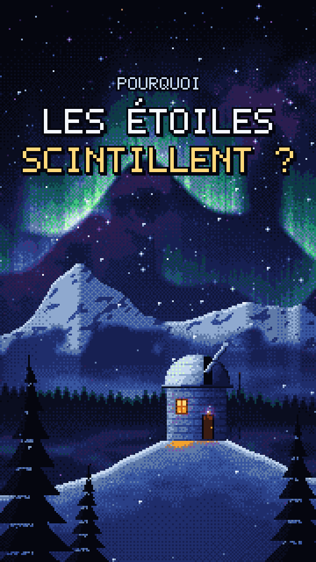
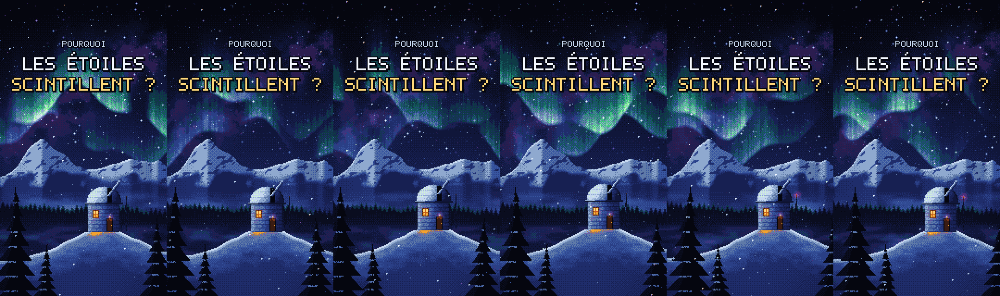

# Video-maker

Kit de direction artistique pour des vidéos verticales dessinées par code, en pixel art,
avec Claude Code et Remotion.



## Pourquoi le rendu est meilleur qu'avec une phrase

| Demande d'une ligne | Ici |
| --- | --- |
| Formes vectorielles lisses | Vraie grille 180x320 agrandie au plus proche voisin |
| Couleurs choisies au hasard | Palette fermée de 28 couleurs, en rampes |
| Dégradés CSS | Tramage ordonné de Bayer entre couleurs voisines |
| Un seul plan | 6 à 7 plans avec parallaxe, brume et lumière cohérente |
| « Ça compile, c'est fini » | Contrôle automatique puis revue des images, deux passes |

Le travail se fait en quatre étapes, chacune guidée par un skill de `.claude/skills/` :
`direction` (le brief), `pixel-art` (la scène), `revue` (regarder et corriger),
`reel` (voix, sous-titres, montage).

## Installation (Windows, macOS, Linux)

```bash
git clone https://github.com/picascience/Video-maker
cd Video-maker
npm install
winget install ffmpeg        # Windows ; macOS : brew install ffmpeg
```

## Utilisation

Ouvrir le dossier dans Claude Code et demander une vidéo : Claude lit `CLAUDE.md`,
rédige le brief, attend l'accord, code la scène, la vérifie et rend le MP4.

```bash
npm run still -- observatoire          # images fixes dans out/stills/
npm run still -- observatoire --sheet  # planche de 6 instants
npm run qa -- observatoire             # boucle, palette, zones sûres
npm run video -- observatoire          # out/observatoire.mp4, 1080x1920
npm run studio                         # Remotion Studio
```

## Organisation

```
CLAUDE.md               règles du projet, lues automatiquement par Claude Code
.claude/skills/         direction, pixel-art, revue, reel
briefs/                 un brief par scène (observatoire.md sert de modèle)
src/engine/             tampon, palette et tramage, bruit bouclé, police bitmap
src/scenes/             une scène = une fonction pure render(frame)
src/remotion/           composant PixelScene et compositions
scripts/                still, qa, video
```


